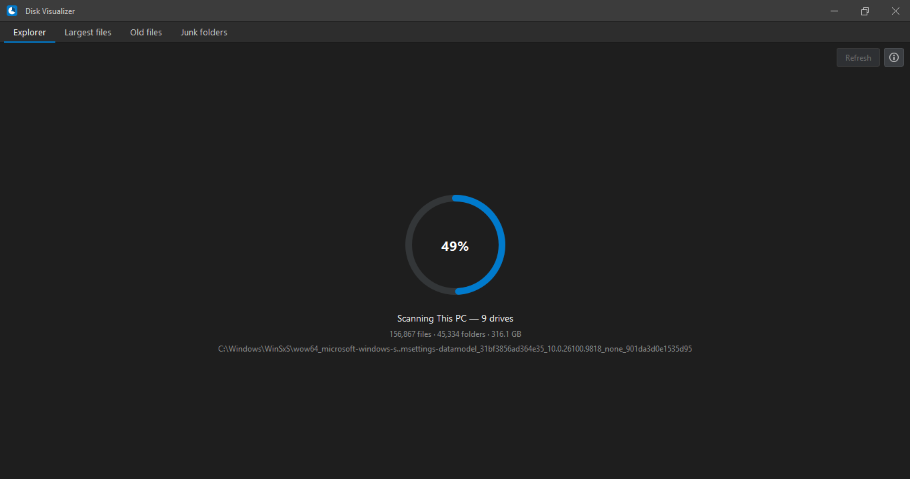
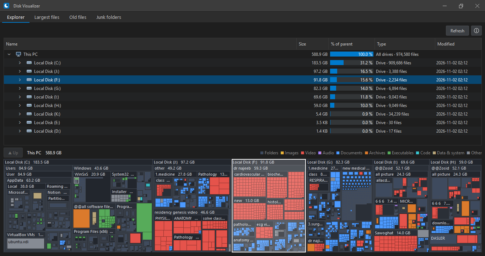
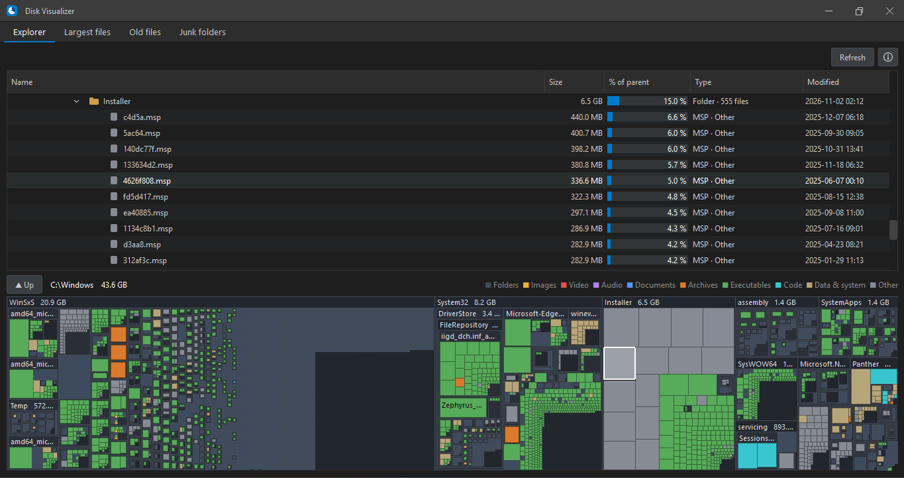
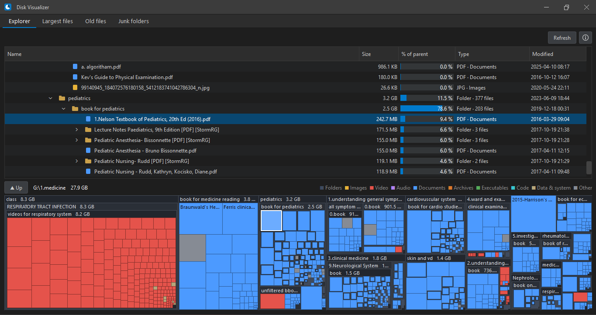
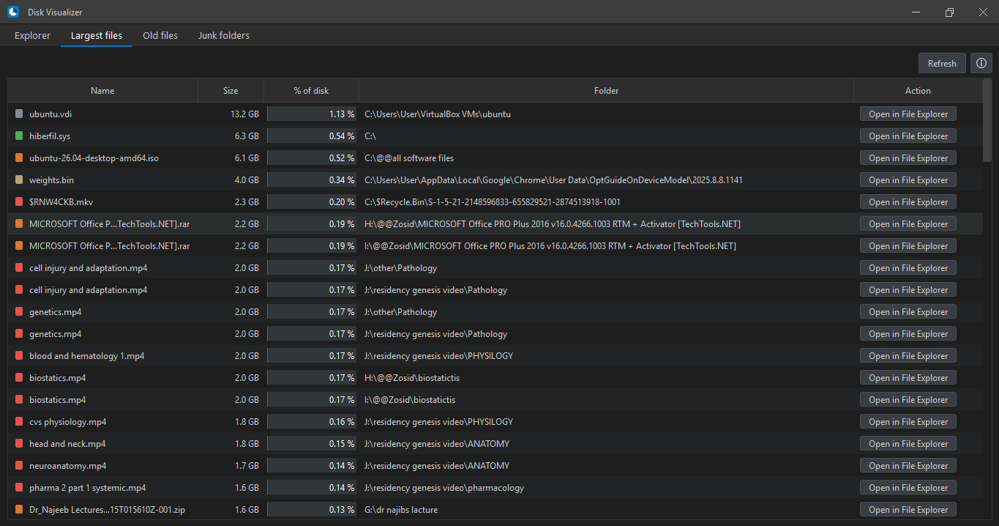
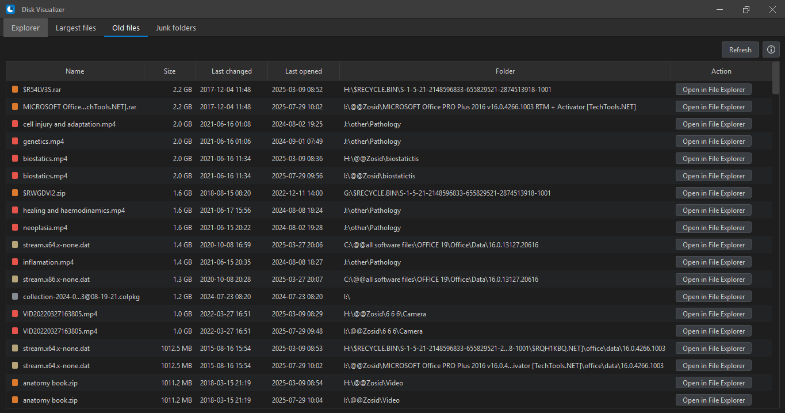
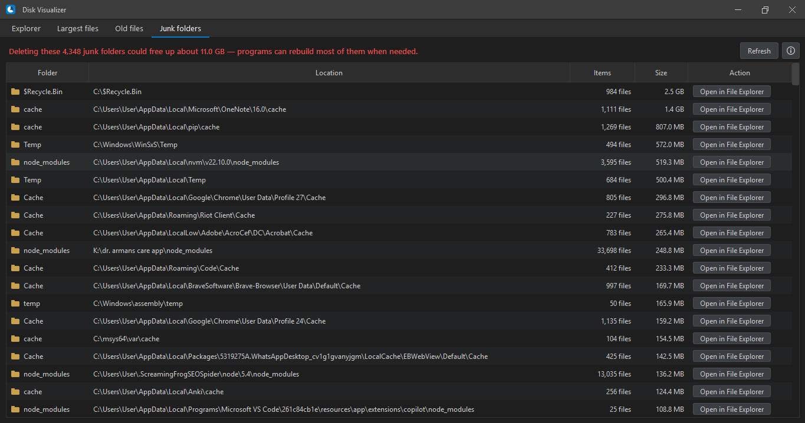

<a id="readme-top"></a>
# About The Project
Disk Visualizer is a high-performance Windows desktop app that shows what is taking up space across all the drives on your PC. It visualizes storage usage using interactive tree views and squarified treemaps, while offering quick tabs to pinpoint your largest files, unedited old files, and temporary junk folders. The app is built with a hybrid architecture: a responsive Python graphical interface backed by a high-speed C core that performs raw file-system crawling and SQLite-backed caching.
<p align="right">(<a href="#readme-top">back to top</a>)</p>

# Built With
- 
- 
- 
- 
- 
<p align="right">(<a href="#readme-top">back to top</a>)</p>

# Project Overview
### Key Features
- **Visual Drive Map:** Shows files as colored boxes — bigger boxes mean bigger files.
- **Fast Rescan:** Re-checks your drives automatically on startup and scans only the folders that changed.
- **Largest Files List:** Finds the 100 biggest files on all your drives.
- **Old Files List:** Shows files you haven't opened or edited for over a year.
- **Junk Folder Finder:** Highlights temporary and cache folders (like `Temp`, `node_modules`, `$Recycle.Bin`) that you can safely clear.
- **One-Click Folder Open:** Click a button to open any file or folder directly in Windows File Explorer.
### The Four Pages
- **Explorer** — The main page with the folder list and colored box map.
- **Largest files** — A list of your 100 biggest files.
- **Old files** — Files not opened for over 1 year.
- **Junk folders** — Temporary folders taking up unnecessary space.
### Project Files
- `gui.py` — The visual window app (Python + PySide6).
- `logic.c` — The fast engine that scans drives and counts sizes (C).
- `logic.dll` — The compiled C engine file used by Python.
<p align="right">(<a href="#readme-top">back to top</a>)</p>

# How To Run The .exe File

1. Go to the [`exe file`](./exe%20file/) folder.
2. Click on `DiskVisualizer.exe` and download it.
3. Double-click `DiskVisualizer.exe` to run the app.

<p align="right">(<a href="#readme-top">back to top</a>)</p>


# How To Run from source code
This project already comes with a built `logic.dll` file, so you can run the app right away in 3 simple steps.

**Step 1. Install Python**  
Download Python from [python.org](https://www.python.org/downloads/). During setup, check **"Add python.exe to PATH"** and keep **"tcl/tk and IDLE"** checked.

**Step 2. Install PySide6**
```bash
pip install PySide6
```

**Step 3. Open CMD and run**
```bash
cd project_folder_path
python gui.py
```

---

**Step 4 (Optional). Creating The .dll File**;
You only need this if you changed `logic.c` yourself.

1. Install MSYS2 from [msys2.org](https://www.msys2.org/) (or run `winget install MSYS2.MSYS2` in Command Prompt)
2. Open **MSYS2 MinGW64** from the Windows Start Menu.
3. Go to the project folder:
```bash
cd project_folder_path
```
4. Run this command:
```bash
gcc -shared -O2 -Wall logic.c -o logic.dll -static -lsqlite3
```
<p align="right">(<a href="#readme-top">back to top</a>)</p>

# Sample Visualizations







<p align="right">(<a href="#readme-top">back to top</a>)</p>
